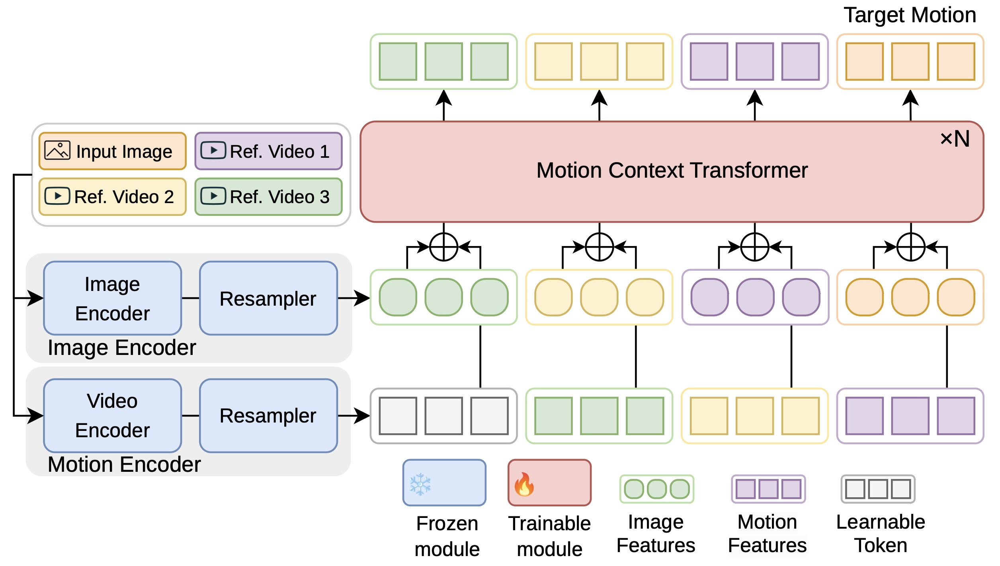
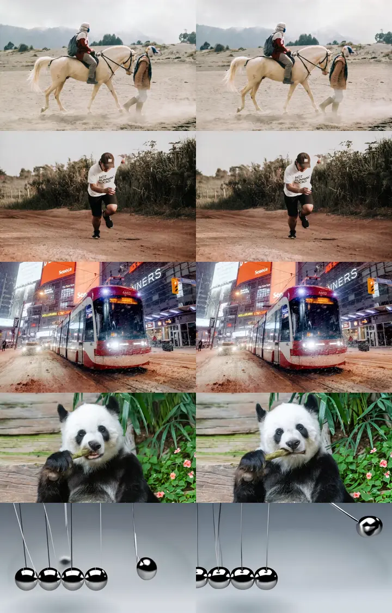

# **[NeurIPS 2025] MotionRAG：用检索增强实现更逼真的视频运动生成**

本文介绍我们在图像到视频生成领域的最新工作：**MotionRAG: Motion Retrieval-Augmented Image-to-Video Generation**。我们提出了一个创新的检索增强生成框架（RAG），通过从真实视频中检索并迁移运动先验，显著提升了生成视频的运动真实感。

随着扩散模型的发展，尽管I2V（Image-to-Video）技术在视觉质量上取得了巨大进步，但生成物理真实、语义连贯的运动仍然是该领域的核心挑战。我们的研究通过引入场景感知运动自适应（Context-Aware Motion Adaptation, CAMA）模块，将运动迁移问题巧妙地转化为一个上下文学习（in-context learning）任务，实现了高效、高质量的跨域运动迁移。目前我们的工作已被 NeurIPS 2025 接收。

项目主页：[https://github.com/MCG-NJU/MotionRAG](https://github.com/MCG-NJU/MotionRAG)

论文链接：[https://arxiv.org/abs/2509.26391](https://arxiv.org/abs/2509.26391)

## **一、背景**

当前的图像到视频生成模型虽然能生成视觉效果惊艳的短片，但在“动起来”这件事上却常常显得力不从心。生成的运动往往缺乏物理真实性，例如物体运动不符合力学规律、人物动作僵硬不自然等。其根本原因在于：

*   **运动的复杂性：** 运动涉及物理约束、物体交互和特定领域的动态规律，这些知识难以通过端到端训练从有限的数据中完全学会。
*   **泛化能力的瓶颈：** 模型很难组合出新颖的场景，比如生成“宇航员在月球上骑马”这种富有想象力的视频，因为缺乏对应的运动先验。

我们研究的一个核心洞察是：**运动本身是可以在不同视觉领域间迁移的**。例如，普通人骑马的运动模式，可以被应用到宇航员骑马的场景中，即使他们的外观、背景完全不同。然而，如何从视频中精准地提取纯粹的运动信息，并将其无缝地应用到新的静态图像上，是一个极具挑战性的问题。

*图1：跨域运动迁移示意图。我们从普通人骑马的视频中检索运动先祝，并将其应用到宇航员的静态图片上，生成了宇航员在月球上骑马的逼真视频，同时完美保留了原图的视觉风格。*

## **二、MotionRAG 框架概览**

为了解决上述挑战，我们提出了 **MotionRAG** 框架，它通过一个简洁高效的三阶段流程，将真实世界的运动先验注入到视频生成过程中：

1.  **检索（Retrieval）：** 根据用户输入的文本提示，从一个大型视频数据库中检索出包含相关运动模式的参考视频。
2.  **自适应（Adaptation）：** 这是我们的核心创新。通过**情境感知运动自适应（CAMA）**模块，将检索到的视频运动特征进行“翻译”和“改造”，使其与目标图像的视觉内容相匹配。
3.  **合成（Synthesis）：** 将经过自适应的运动特征作为额外的引导信号，注入到预训练的I2V扩散模型中，生成最终的视频。

整个流程十分高效，在推理时仅增加几秒钟的额外开销，却能带来显著的运动质量提升。

*图2：MotionRAG 框架流程图。*

## **三、核心技术：情境感知运动自适应（CAMA）**

如何让模型“看懂”检索到的运动，并“领悟”如何将其应用到一张全新的图片上？我们借鉴了大语言模型（LLM）中上下文学习（In-context Learning）的思想，设计了CAMA模块。

*图3：CAMA 模块架构图。*

其核心设计思想如下：

1.  **高层语义特征提取：** 我们使用预训练的VideoMAE和DINO模型，分别从检索视频和图像中提取高层的、解耦了外观的**语义运动特征**和**外观特征**。这比传统的光流等底层特征更具鲁棒性和可迁移性。

2.  **上下文学习序列构建：** 我们将检索到的多个“（参考图像外观，参考视频运动）”样本对，与待生成的“（目标图像外观，未知目标运动）”一起，构成一个学习序列。一个巧妙的设计是，我们按**相似度从低到高**的顺序排列参考样本，让模型先从差异大的样本中学习通用的迁移规律，再逐步聚焦到与目标更相关的样本上。

3.  **因果注意力机制（Causal Attention）：** 我们采用一个Causal Transformer结构来处理这个序列。在预测目标运动时，模型可以“参考”所有在它之前的样本对，从而在上下文中动态地学会如何根据目标图像的外观来调整和生成最合适的运动特征。

4.  **即插即用的运动注入器（Motion-Adapter）：** 我们设计了一个轻量级的Motion-Adapter，通过交叉注意力机制将CAMA输出的运动特征无缝注入到任何主流的I2V扩散模型（如SVD, Dynamicrafter）的生成过程中，且无需修改原始模型结构，实现了真正的即插即用。

## **四、实验结果**

**1. 定量分析：全面超越基线模型**

我们在多个主流I2V模型（包括Dynamicrafter, CogVideoX）上进行了实验。结果显示，集成MotionRAG后，所有模型在各项指标上均获得显著提升，尤其是在衡量运动语义准确性的**Action**上。例如，在Dynamicrafter上提升了8.6分，在最先进的CogVideoX上也提升了5.9分。这一切的代价是，推理时间仅增加了不到4秒。

| Model               | Action ↑    | DINO ↑            | FVD ↓             | Inference Time      |
|---------------------|------------------|-------------------|-------------------|---------------------|
| CogVideoX           | 59.9             | 87.8              | 87.1              | 59.4s               |
| CogVideoX + RAG     | **65.8 (+9.9%)** | **89.4 (+1.8%)**  | **80.2 (-8.0%)**  | 63.0s (+3.6s)       |
| DynamiCrafter       | 53.5             | 85.8              | 88.4              | 87.6s               |
| DynamiCrafter + RAG | **62.1 (+16.1%)** | **88.4 (+3.0%)**  | **69.0 (-22.0%)** | 89.4s (+1.8s)       |

**2. 零样本泛化：轻松驾驭新领域**

MotionRAG最令人兴奋的特性之一是其强大的零样本泛化能力。我们只需更换一个特定领域的视频数据库（如包含教学视频的SkillVid），**无需重新训练任何模型组件**，就能让模型生成该领域的专业、逼真的动作。实验证明，该方法在教学视频生成的表现同样出色。

| Model (on SkillVid) | Action ↑    | DINO ↑            | FVD ↓              |
|---------------------|------------------|-------------------|--------------------|
| CogVideoX           | 51.5             | 78.7              | 91.8               |
| CogVideoX + RAG     | **53.5 (+3.9%)** | **81.8 (+3.9%)**  | **83.2 (-9.4%)**   |
| DynamiCrafter       | 49.6             | 82.9              | 108.5              |
| DynamiCrafter + RAG | **50.1 (+1.0%)** | 80.5 (-2.9%)      | **89.4 (-17.6%)**  |

**3. 鲁棒性与泛化性验证**

消融实验表明：
*   我们的CAMA模块远优于简单的特征平均或只用最相似视频的方案。
*   即使检索到的参考视频是完全随机的（噪声），我们的模型依然能生成比基线模型好得多的合理运动，展现了极强的鲁棒性。
*   即使从一个数据分布（OOD）不同的超大规模数据库（InternVid-10M）中检索，模型性能依然强劲，证明了其学习到的是可泛化的运动迁移规律，而非对特定数据库的过拟合。

| Method                        | Action ↑          | DINO ↑           | FVD ↓             |
|-------------------------------|-------------------|------------------|-------------------|
| _Motion Adaptation Strategy_  |                   |                  |                   |
| Baseline (No RAG)             | 53.5              | 85.8             | 88.4              |
| Top-1 Retrieval (Top-1)       | 54.7 (+2.2%)      | 86.6 (+0.9%)     | 82.9 (-6.2%)      |
| Average Features (Avg-9)      | 57.9 (+8.2%)      | 88.3 (+2.9%)     | 78.7 (-11.0%)     |
| **Ours (MCT-9)**              | **62.1 (+16.1%)** | **88.4 (+3.0%)** | **69.0 (-22.0%)** |
| _Robustness & Generalization_ |                   |                  |                   |
| Ours (w/ Random Retrieval)    | 60.7 (+13.5%)     | 87.6 (+2.1%)     | 77.5 (-12.3%)     |
| Ours (w/ OOD Database)        | 60.9 (+13.8%)     | 87.4 (+1.9%)     | 70.7 (-20.0%)     |

**4. 效果展示：让运动更“真实”**

*图4：基线模型（左侧）与使用MotionRAG后（右侧）的定性对比。*

从上图可以看出，MotionRAG显著改善了多种场景下的运动质量：
*   **物理规律：** 将基线模型中牛顿摆不符合物理规律的“漂浮”，修正为逼真的往复摆动。
*   **生物动态：** 将基线模型中奔跑者和马匹僵硬的“闪烁式”运动，修正为流畅、有周期的步态。
*   **主体动画：** 将基线模型中几乎静止的人物和电车，赋予了自然、连贯的运动。

更多精彩的视频对比效果，请访问我们的项目主页。
[https://github.com/MCG-NJU/MotionRAG](https://github.com/MCG-NJU/MotionRAG)

## **五、总结**

本文提出了 **MotionRAG**，一个通过检索增强来提升I2V生成运动真实感的通用框架。我们的核心贡献包括：
1.  **一个新颖的检索增强框架**，有效利用真实视频作为运动先验。
2.  **创新的CAMA模块**，首次将运动迁移问题建模为上下文学习任务，实现了高效的跨域自适应。
3.  **强大的即插即用能力和零样本泛化性**，只需更换数据库即可适应新领域，且计算开销极小。

我们的工作证明了将检索机制与生成模型相结合的巨大潜力，为构建更真实、更可控的下一代视频生成系统提供了一个有力的范式。

